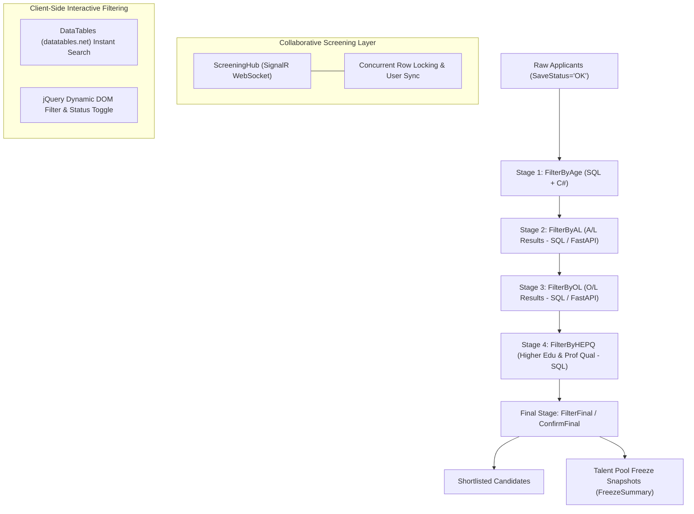

# JobAppHR — Technologies, Libraries, and Filtering Architecture

> **Document Type:** Technical Architecture & Dependency Reference  
> **Project Name:** JobAppHR (SLTMobitel Recruitment & Screening System)  
> **Target Framework:** .NET 6.0 (`net6.0`)  
> **Architecture:** ASP.NET Core MVC with Repository Pattern, SignalR Collaborative Screening, and FastAPI Integration  

---

## 1. Executive Summary

**JobAppHR** is an enterprise human resource and candidate screening platform built for **SLTMobitel** (Sri Lanka Telecom). The application manages recruitment pipelines across two operational modes:
- **Auto Filtering Pipeline:** Multi-stage automated validation against predefined criteria (Age, A/L exam scores, O/L exam scores, and Higher Education / Professional Qualifications).
- **Manual Screening & Talent Pool (TP) Processing:** Collaborative, multi-officer screening of candidate applications with real-time row locking, applicant history tracking, and talent pool freeze snapshots.

---

## 2. All Technologies and Libraries Used in the Project

### 2.1 Backend Framework & Core Runtime

| Technology / Component | Version / Specification | Description & Role in the Project |
| :--- | :--- | :--- |
| **.NET SDK / C#** | .NET 6.0 (`net6.0`), C# 10 | Target runtime environment and language for the entire web application. |
| **ASP.NET Core MVC** | `Microsoft.NET.Sdk.Web` (6.0) | Web framework providing MVC architecture (Controllers, Razor Views, Models, Partial Views). |
| **Dependency Injection** | Built-in ASP.NET Core DI Container | Service lifetime management configuring Scoped repositories (`IDBOperations`, `IFilterProcess`, `IManualProcess`, `IFastAPIProcess`, `IUtilityFn`) and Singleton accessors (`IHttpContextAccessor`). |
| **ASP.NET Core SignalR** | Built-in Core Library (`Microsoft.AspNetCore.SignalR`) | Real-time bidirectional WebSocket/long-polling communication engine powering multi-user collaborative screening sessions. |
| **Session & Distributed Cache** | `AddDistributedMemoryCache`, `AddSession` | Manages authenticated user session state, idle timeouts, and cookie tracking. |
| **FormOptions Config** | `Microsoft.AspNetCore.Http.Features` | Configured with `ValueCountLimit = 10000` to allow large batch submissions of applicant tables. |

---

### 2.2 Direct NuGet Packages (`JobAppHR.csproj`)

| Package Name | Version | Usage in Project |
| :--- | :--- | :--- |
| **`Microsoft.Data.SqlClient`** | `5.2.0` | Official Microsoft SQL Server ADO.NET provider. Manages database connections (`SqlConnection`), command execution (`SqlCommand`), and data adapters (`SqlDataAdapter`). |
| **`AutoMapper`** | `13.0.1` | Object-to-object mapper used for projecting entities and database results to presentation ViewModels. |
| **`Fingers10.ExcelExport`** | `3.0.1` | Lightweight library for generating and downloading styled Microsoft Excel (`.xlsx`) files directly from collections and `DataTable` objects. |
| **`Swashbuckle.AspNetCore`** | `6.5.0` | Swagger / OpenAPI tooling for API documentation and endpoint testing. |
| **`Microsoft.VisualStudio.Web.CodeGeneration.Design`** | `6.0.18` | ASP.NET Core tooling for controller and Razor view scaffolding during development. |

---

### 2.3 Transitive & Framework Assemblies Used in Code

| Library / Assembly | Source / Origin | Usage in Project |
| :--- | :--- | :--- |
| **`Newtonsoft.Json` (Json.NET)** | Transitive Dependency | Utilized in `UtilityFn.cs` and `FilterProcess.cs` (`JToken`, `JArray`, `JObject`, `JsonConvert`) for JSON parsing, string-to-DataTable conversions, and parsing external API responses. |
| **`DocumentFormat.OpenXml`** | Dependency of `Fingers10.ExcelExport` | Low-level OpenXML spreadsheet manipulation library for generating Excel documents without requiring Microsoft Office. |
| **`Microsoft.AspNetCore.Authentication.Cookies`** | ASP.NET Core Framework | Cookie-based authentication middleware supporting dual-mode authentication (Azure AD claims in production, `DevLogin` fallback for local development). |
| **`System.Data` / `System.Data.Common`** | .NET BCL | Tabular data representations (`DataTable`, `DataRow`, `DataColumn`, `DataSet`) used across all database repository operations. |

---

### 2.4 External Microservices & Integration

| Service / Technology | Protocol / Format | Purpose |
| :--- | :--- | :--- |
| **Python FastAPI Microservice** | REST (HTTP / JSON / `multipart/form-data`) | External service running at `http://124.43.136.188` used for bulk applicant uploads (`/upload_bulk`), qualification matching (`/filter_by_position/`), and metadata purging (`/metadata/delete_all/`). |
| **`System.Net.Http.HttpClient`** | HTTP/1.1 & HTTP/2 | Asynchronous HTTP client configured with custom timeouts, `MultipartFormDataContent`, and `ByteArrayContent` to interface with the FastAPI server. |
| **Microsoft SQL Server** | TCP/IP, Port 1433 / Named Pipes (`SQLEXPRESS`) | Primary relational database storing applicant records, educational qualifications, exam results, intake settings, master tables, and filtering stage audit logs. |

---

### 2.5 Frontend Technologies & Client-Side Libraries

All client-side libraries are installed in `wwwroot/lib/` and managed via **LibMan (`libman.json`)**:

| Library | Version / Provider | File Location | Purpose & Features |
| :--- | :--- | :--- | :--- |
| **Bootstrap** | `v5.1.0` | `wwwroot/lib/bootstrap/` | Responsive UI grid system, navbar, buttons, cards, modals, form controls, and flexbox utilities. |
| **jQuery** | `v3.5.1` | `wwwroot/lib/jquery/` | DOM manipulation, AJAX requests, form serializations, dynamic event handling, and table manipulations. |
| **DataTables** | `v2.1.2` / `v2.0.2` (`cdnjs`) | `wwwroot/lib/datatables.net/`, `wwwroot/lib/datatable/` | Advanced client-side table rendering, sorting, pagination, and real-time live search filtering. |
| **SignalR Client** | `v6.0.25` (`jsdelivr`) | `wwwroot/lib/signalr/signalr.min.js` | JavaScript SignalR client establishing WebSocket connections to `/hubs/screening` for collaborative row locking. |
| **Font Awesome** | `v6.5.2` (`cdnjs`) | `wwwroot/lib/font-awesome/` | Scalable vector icon set (`fa-solid`, `fa-user`, `fa-gear`, `fa-info-circle`, etc.). |
| **SweetAlert** | `v2.1.2` (`cdnjs`) | `wwwroot/lib/sweetalert/` | Interactive modal popups for confirmation dialogs (e.g., confirming filter stage updates, finalizing shortlists). |
| **Bootstrap-Select** | — | `wwwroot/lib/bootstrap-select/` | Enhanced dropdown controls with live search and multi-select capabilities. |
| **Datepicker** | — | `wwwroot/lib/datepicker/` | Date selection controls for intake closing dates, birth date filters, and date range lookups. |
| **jQuery Validation** | — | `wwwroot/lib/jquery-validation/` | Client-side input validation engine. |
| **jQuery Unobtrusive** | — | `wwwroot/lib/jquery-validation-unobtrusive/` | Bridges ASP.NET Core data annotations with client-side jQuery validation. |
| **Custom Styling** | Vanilla CSS3 | `wwwroot/css/` (`site.css`, `variables.css`, `animations.css`) | Design tokens, color system, elevation shadows, keyframe animations, and custom UI components. |

---

## 3. Technologies and Libraries Used for Filtering

The filtering system in `JobAppHR` is designed as a **hybrid multi-stage filtering architecture**, spanning database queries, in-memory C# evaluation, an external Python FastAPI evaluation microservice, real-time multi-officer screening via SignalR, and client-side table filtering.



---

### 3.1 Database-Level Filtering Engine (T-SQL & ADO.NET)

- **Library / Driver:** `Microsoft.Data.SqlClient` (v5.2.0)
- **Primary Source Files:** [FilterProcess.cs](file:///c:/Users/WW/Desktop/SLT%20Project%201/JobAppHR/Repository/FilterProcess.cs), [ManualProcess.cs](file:///c:/Users/WW/Desktop/SLT%20Project%201/JobAppHR/Repository/ManualProcess.cs), [DBOperations.cs](file:///c:/Users/WW/Desktop/SLT%20Project%201/JobAppHR/Repository/DBOperations.cs)

The core filtering logic is executed directly inside Microsoft SQL Server via raw SQL statements optimized with joins, string parsing functions, and conditional aggregations:

1. **Stage 1 — Age Filtering (`FilterByAge`):**
   - Filters candidate records where `Overage = ''`, `SaveStatus = 'OK'`, and `Processed IS NULL`.
   - Formats age values using `CONCAT(AgeYears, 'Y ', AgeMonths, 'M ', AgeDays, 'D')`.
   - Employs dynamic SQL string parsing to extract and sort by sequential application sequence numbers:
     ```sql
     ORDER BY CAST(SUBSTRING(ApplicationCode, CHARINDEX('/', ApplicationCode, CHARINDEX('/', ApplicationCode) + 1) + 1, LEN(ApplicationCode)) AS INT)
     ```
2. **Stage 2 & 3 — Exam Qualification Filtering (`FilterByAL_Org`, `FilterByOL_Org`):**
   - Checks candidate eligibility against `SEResult`, `SEExam`, `Grade`, and `Application` tables.
   - Evaluates passing grades by counting ratings above zero:
     ```sql
     SELECT B.ApplicationCode, B.ExamYear, B.ExamCode, Count(G.Rating) AS Score 
     FROM SEResult A
     INNER JOIN SEExam B ON A.ApplicationCode = B.ApplicationCode
     INNER JOIN Application C ON B.ApplicationCode = C.ApplicationCode
     INNER JOIN Grade G ON A.Grade = G.GradeValue
     WHERE C.IntakeCode = @IntakeCode AND A.ExamCode = 'A/L' AND G.Rating > 0
     GROUP BY B.ApplicationCode, B.ExamYear, B.ExamCode
     ```
   - Only candidates with `Score >= 3` (e.g., three passes for A/L) are marked as eligible.
3. **Stage 4 — Higher Education & Professional Qualification Filtering (`FilterByHEPQ`):**
   - Joins applicant records with `HigherEducation`, `HEInstitute`, `ProfessionalQualification`, and `PQInstitute` tables to verify degrees and accredited professional memberships.
4. **State Management & Audit Tracking (`FilteredData` Table):**
   - Tracks candidates through intermediate states: `CurrentStage` (1, 2, 3, 4, `FINAL`), `CurrentStatus` (`PASS`, `FAIL`, `TO-CHECK`), update timestamps (`Stage1UpdatedOn`, `Stage2UpdatedOn`, etc.), and user remarks.
   - Stage progress metrics use conditional SQL aggregation:
     ```sql
     SELECT SUM(CASE WHEN CurrentStatus = 'TO-CHECK' THEN 1 ELSE 0 END) AS ToCheck_Count,
            SUM(CASE WHEN CurrentStatus = 'PASS' THEN 1 ELSE 0 END) AS Pass_Count,
            Max(Stage4UpdatedOn)
     FROM FilteredData WHERE IntakeCode = @IntakeCode AND CurrentStage = '4'
     ```

---

### 3.2 In-Memory C# Data Processing & LINQ

- **Technologies:** C# 10, .NET 6.0 BCL (`System.Data`, `System.Linq`, `System.Reflection`)
- **Primary Source Files:** [FilterProcess.cs](file:///c:/Users/WW/Desktop/SLT%20Project%201/JobAppHR/Repository/FilterProcess.cs), [UtilityFn.cs](file:///c:/Users/WW/Desktop/SLT%20Project%201/JobAppHR/Repository/UtilityFn.cs)

- **`DataTable.Select()` Filtering:**
  In-memory sub-queries against loaded data tables for high-speed record cross-referencing:
  ```csharp
  drs = scoretbl.Select("ApplicationCode = '" + applicationCode + "'");
  drs = resulttbl.Select("ApplicationCode = '" + applicationCode + "'");
  drs = maintbl.Select("ApplicationCode = '" + applicationCode + "'");
  ```
- **LINQ to Objects:**
  Extracts, projects, and maps tabular data to strongly-typed models:
  ```csharp
  var columnNames = dataTable.Columns.Cast<DataColumn>().Select(c => c.ColumnName.ToLower()).ToList();
  ```
- **Reflection-Based Model Mapping:**
  `UtilityFn.ConvertToList<T>(DataTable dataTable)` dynamically instantiates and populates filter models (`AgeFilter`, `ALFilter`, `OLFilter`, `HEPQFilter`, `FinalFilter`, `FilterSummary`).

---

### 3.3 External AI / Microservice Filtering (Python FastAPI)

- **Libraries / Technologies:** `System.Net.Http.HttpClient`, `Newtonsoft.Json.Linq` (`JToken`, `JArray`, `JObject`), `MultipartFormDataContent`, `ByteArrayContent`
- **Primary Source Files:** [FastAPIProcess.cs](file:///c:/Users/WW/Desktop/SLT%20Project%201/JobAppHR/Services/FastAPIProcess.cs), [FilterProcess.cs](file:///c:/Users/WW/Desktop/SLT%20Project%201/JobAppHR/Repository/FilterProcess.cs)

The application includes an integration layer with an external Python FastAPI service for automated candidate matching:
1. **CSV Exporting:** `UtilityFn.ConvertToCSV()` exports filtered applicant metadata (`AppData.csv`) and exam records (`ResultData.csv`).
2. **Bulk Upload:** `FastAPIProcess.UploadApplicationData()` sends multipart form payloads to `/upload_bulk`.
3. **Position Filtering:** Invokes `/filter_by_position/?position={positionCode}&max_age=60&intake_code={intakeCode}`.
4. **JSON Deserialization:** `UtilityFn.GetEligibleApplicationCodes()` parses the JSON response using `Newtonsoft.Json.Linq.JArray` to extract eligible application numbers.
5. **Resilient Fallback:** When FastAPI is disabled or unavailable, the system automatically falls back to native T-SQL/C# filtering methods (`FilterByAL_Org`, `FilterByOL_Org`).

---

### 3.4 Real-Time Collaborative Screening & Concurrency (SignalR)

- **Libraries:**
  - Backend: `Microsoft.AspNetCore.SignalR`
  - Frontend: `@microsoft/signalr` (v6.0.25)
- **Primary Source Files:** [ScreeningHub.cs](file:///c:/Users/WW/Desktop/SLT%20Project%201/JobAppHR/Hubs/ScreeningHub.cs), [Program.cs](file:///c:/Users/WW/Desktop/SLT%20Project%201/JobAppHR/Program.cs#L128)

In manual and multi-officer screening workflows, concurrent reviewer race conditions are prevented using SignalR:
- **Intake Group Isolation:** Reviewers join an intake-specific SignalR group via `JoinIntakeGroup(intakeCode, stage, status)`.
- **In-Memory Row Locking:** Uses thread-safe `ConcurrentDictionary<string, RowLock>` to lock an applicant's row when an HR officer opens it for screening.
- **Real-Time Broadcasts:**
  - `ReceiveStatusUpdate`: Broadcasts `PASS`, `FAIL`, or `TO-CHECK` status transitions and remarks to all active reviewers instantly.
  - `ReceiveCurrentLocks`: Synchronizes locked applicants to newly joined officers to prevent duplicate evaluations.
  - `ReceiveActiveUsers`: Displays online HR personnel screening the current intake batch.

---

### 3.5 Client-Side Table Filtering & Interactive UI

- **Libraries:**
  - **DataTables (`datatables.net` v2.1.2 & `datatable` v2.0.2)**
  - **jQuery (v3.5.1)**
  - **SweetAlert (v2.1.2)**
- **Primary Views:** [FilterByAge.cshtml](file:///c:/Users/WW/Desktop/SLT%20Project%201/JobAppHR/Views/FilterProcess/FilterByAge.cshtml), `FilterByAL.cshtml`, `FilterByOL.cshtml`, `FilterByHEPQ.cshtml`, `FilterFinal.cshtml`, `ShowFinal.cshtml`, `ShowFail.cshtml`

- **Instant In-Browser Table Filtering:**
  DataTables enables instant search filtering across all candidate columns (Application Code, Name, NIC, DOB, Age, Remarks) without page reload:
  ```javascript
  $('#datagrid').DataTable({
      "paging": false,
      columnDefs: [
          { targets: [0], "orderable": false },
          { targets: [$('thead tr th').length - 1], "orderable": false }
      ]
  });
  ```
- **Filter-Aware Submission Safeguard:**
  Prevents accidental partial submission when a search filter is active:
  ```javascript
  $('input[type="search"]').on('input', function () {
      if ($(this).val() != "") {
          $("#btnProceed").prop("disabled", true);
      } else {
          $("#btnProceed").prop("disabled", false);
      }
  });
  ```
- **Dynamic Checkbox Filtering:**
  Interactive checkboxes update hidden input fields (`PASS` vs `FAIL`) in real-time before batch POSTing back to `FilterProcessController`.
- **SweetAlert Confirmation:**
  Provides confirmation dialogs before finalizing batches or freezing talent pool candidate lists.

---

### 3.6 Talent Pool Freezing & Filtered Data Export

- **Libraries:** `Fingers10.ExcelExport` (v3.0.1) & `DocumentFormat.OpenXml`
- **Primary Source Files:** [EligibleApplicantController.cs](file:///c:/Users/WW/Desktop/SLT%20Project%201/JobAppHR/Controllers/EligibleApplicantController.cs), [FilterProcess.cs](file:///c:/Users/WW/Desktop/SLT%20Project%201/JobAppHR/Repository/FilterProcess.cs)

- **Talent Pool Snapshots:** Once filtering is completed, candidate lists can be snapshotted with an incremental `FreezeNo` (`FreezeSummary` table) allowing future intakes to draw candidates from prior pools without re-evaluating raw submissions.
- **Excel Export:** Shortlisted candidates and filtered audit lists can be downloaded as formatted `.xlsx` spreadsheets via `Fingers10.ExcelExport.ActionResults.ExcelResult<T>`.

---

## 4. Comprehensive Comparison & Summary Table

| Category | Technology / Library | Version | Role in Overall Project | Role in Filtering |
| :--- | :--- | :--- | :--- | :--- |
| **Framework** | **ASP.NET Core MVC** | 6.0 | Main web application framework | Hosts controllers, views, and routing for auto and manual filtering workflows |
| **Language & Runtime** | **C# / .NET** | C# 10 / .NET 6.0 | Application programming language | Implements filtering domain logic, reflections, and type conversions |
| **Database** | **Microsoft SQL Server** | Express / Standard | Enterprise relational database | Stores raw applications, exam results, and tracks filtering stage progress |
| **Data Provider** | **`Microsoft.Data.SqlClient`** | 5.2.0 | ADO.NET SQL Server connectivity | Executes raw SQL queries with complex `WHERE`, `JOIN`, and `GROUP BY` criteria |
| **Real-Time Engine** | **SignalR (`ScreeningHub`)** | 6.0 (Server) / 6.0.25 (Client) | WebSocket communication | Coordinates multi-reviewer screening, real-time row locking, and status sync |
| **External AI / API** | **Python FastAPI Microservice** | HTTP REST | External candidate evaluation service | Performs bulk qualification matching (`/filter_by_position/`) |
| **HTTP Client** | **`System.Net.Http.HttpClient`** | .NET 6.0 BCL | Sends HTTP requests to external APIs | Uploads CSV candidate datasets to FastAPI via multipart form data |
| **Data Serialization** | **`Newtonsoft.Json`** | 13.x | JSON handling | Deserializes JSON arrays of eligible applicant codes returned by FastAPI |
| **Excel Generation** | **`Fingers10.ExcelExport`** | 3.0.1 | Excel generation | Exports final filtered and shortlisted applicant reports to `.xlsx` |
| **OpenXML Tooling** | **`DocumentFormat.OpenXml`** | 2.13.0+ | Office Open XML file format manipulation | Underlying engine used by `Fingers10.ExcelExport` |
| **Object Mapper** | **`AutoMapper`** | 13.0.1 | ViewModel mapping | Maps tabular database rows to presentation models |
| **CSS Framework** | **Bootstrap** | 5.1.0 | Responsive layout and UI styling | Styles filtering forms, summary cards, badges, and modals |
| **JavaScript Utility** | **jQuery** | 3.5.1 | Client scripting | Handles checkbox status toggles, AJAX partial loading, and search listeners |
| **Interactive Grid** | **DataTables (`datatables.net`)** | 2.1.2 & 2.0.2 | Interactive table rendering | Provides client-side instant search, sorting, and responsive table views |
| **Dialogs / Alerts** | **SweetAlert** | 2.1.2 | Enhanced dialogs | Displays confirmation modals prior to batch filtering and freezing actions |
| **Icons** | **Font Awesome** | 6.5.2 | Iconography | Visual cues for stage status, info buttons, user roles, and actions |
| **Package Manager** | **LibMan (Library Manager)** | 1.0 | Client-side package management | Pulls frontend libraries from `cdnjs` and `jsdelivr` |
